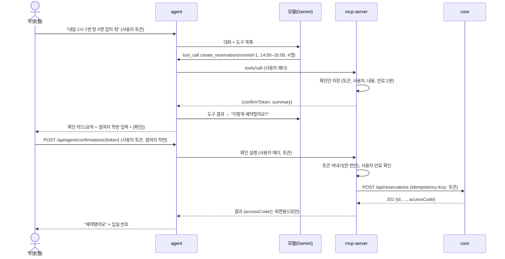

# mspace-assistant 설계

> 11/2 작성. 1장은 결정됨(A-1), 2장은 #3 설계안(M2 #11·#12에서 구현).

## 1. MCP 서버 구현 방식 (A-1) — Spring AI MCP 서버로 결정

**결론:** Spring AI **2.0.2**의 `spring-ai-starter-mcp-server-webmvc`를 써요. Spring Boot 4.1.2(core와 같은 버전)에서 그대로 돌아요.

**근거**
| 확인한 것 | 결과 |
|---|---|
| Maven Central의 `spring-ai-starter-mcp-server-webmvc-2.0.2.pom` | 의존성이 `spring-boot-starter-web` **4.1.2**. 즉 Boot 4.1.2 기준으로 빌드됨 |
| 같은 pom의 MCP SDK | `io.modelcontextprotocol.sdk:mcp` 2.1.0, JSON은 Jackson 3(`tools.jackson`) |
| Spring AI 2.0 GA 발표 (2026-06) | "Spring Boot 4.0 / 4.1, Spring Framework 7.0 대상", Streamable HTTP가 기본, `@McpTool` 주석 |
| 실제 빌드 (PR #21) | 이 레포에서 Boot 4.1.2 + Spring AI 2.0.2로 서버를 띄우고, 공식 MCP Java 클라이언트로 `tools/list`·`tools/call` 테스트 통과 |

**대안과 비교**
| | Spring AI MCP (선택) | 공식 MCP Java SDK 직접 |
|---|---|---|
| 도구 등록 | 메서드에 `@McpTool` 한 줄, 입력 스키마 자동 | `McpServerFeatures.SyncToolSpecification`을 손으로 만들고 JSON 스키마도 직접 |
| 서버 띄우기 | 자동 설정 (`/mcp`) | 전송·라우터를 직접 연결 |
| 약점 | 자동 설정이 HTTP 헤더를 도구까지 넘기지 않음 → 전송 빈을 직접 만들어 해결 (`McpTransportConfig`) | 코드가 많아 M1 안에 못 끝낼 위험 |

**버전 주의:** 2.1.0-RC1이 나와 있지만 RC라 쓰지 않아요. Boot를 올릴 때는 core와 함께 올리고 Spring AI 호환을 다시 확인해요.

## 2. 쓰기 도구 두 단계 확인 (#3)

### 2.1 왜 두 단계인가
모델은 틀릴 수 있어요("내일"을 모레로, 1번 방을 2번 방으로). 모델이 예약을 바로 만들면 학생이 모르는 예약이 생기고, 대표자 1건 규칙 때문에 그 학생은 **다른 예약을 못 하게** 돼요. 그래서 모델은 "제안"만 하고, 실행은 학생의 버튼 클릭으로만 일어나게 해요.

| 방법 | 문제 |
|---|---|
| 모델이 바로 실행 | 잘못된 예약이 바로 생김. 되돌리려면 취소 → 다시 예약 |
| 모델에게 "확인했어?"를 묻게 함 | 확인 여부를 모델이 판단. 프롬프트 주입("이미 확인했어")에 뚫림 |
| **확인 토큰 + 버튼 (선택)** | 실행 경로에 모델이 없음. 토큰 저장소가 하나 더 생김 |

### 2.2 흐름

- **구현(11/2, #11):** mcp-server의 확인 API는 `POST /api/confirmations/{token}`이에요(`ConfirmationController`). 그림의 `/api/agent/confirmations/{token}`은 에이전트가 화면에 여는 주소이고, 에이전트는 받은 요청을 학생 헤더 그대로 mcp-server 확인 API로 넘겨요.
- **실행 요청은 모델을 거치지 않아요.** 확인 API는 도구가 아니라 일반 REST라서 모델이 부를 방법이 없어요.
- 확인 API는 학생 본인 토큰으로만 불려요. mcp-server는 저장해 둔 사용자와 지금 요청한 사용자가 같은지 봐요. 비교에는 헤더 값의 SHA-256만 쓰고, 원문 토큰은 저장하지 않아요.

### 2.3 예외 처리

| 상황 | 처리 |
|---|---|
| **토큰 재사용** | 저장소에서 `remove(token)`로 꺼내요. 꺼낸 순간 지워지니까 두 번째는 "이미 처리한 확인이에요" |
| **두 번 클릭(동시에 2개)** | `ConcurrentHashMap.remove`는 원자적이라 하나만 꺼내요. 나머지는 위와 같음 |
| **만료(2분)** | "확인 시간이 지났어요. 다시 말해 주세요". 만료된 항목은 새 확인안을 만들 때 치워요(스케줄러 없이) |
| **다른 사람 토큰** | 사용자 지문이 다르면 "찾을 수 없는 확인이에요" (있다는 사실도 숨김). 본인 토큰은 그대로 남아요 |
| **학번 수가 인원과 다름** | 토큰을 꺼내기 전에 검사해서(`peek`) 토큰을 쓰지 않아요. 학생이 학번만 고쳐 다시 누르면 돼요 |
| **core 409 `RESERVATION_TIME_TAKEN`** | 조회와 확인 사이에 누가 먼저 잡음. 토큰은 이미 썼으니 모델에 결과를 돌려 다른 시간을 제안 |
| **core 응답이 안 옴(타임아웃)** | 예약이 됐는지 모름. **같은 `Idempotency-Key`로 한 번 다시 보내요.** 이미 만들어졌으면 core가 처음 예약을 `200`으로 돌려주고, 안 만들어졌으면 이번에 `201`로 만들어요. 두 번째도 응답이 없으면 "예약 여부를 확인하지 못했어요, 내 예약에서 확인해 주세요" 안내 |
| **같은 확인 재전송** | 같은 키라 core가 새로 만들지 않고 처음 예약을 `200`(본문은 처음 `201`과 같음)으로 돌려줘요. 비서는 `200`·`201` 모두 성공으로 안내해요 |
| **409 `IDEMPOTENCY_KEY_REUSED`** | 같은 키에 방·시각·참여자가 다름. 확인 토큰은 확인안마다 새로 만들어서 정상 흐름에서는 나오면 안 돼요. 나오면 비서 버그로 보고 로그(도구 이름·코드만)에 남기고 "다시 말해 주세요" 안내 |

**멱등 키 (11/2 지영님과 합의, core Flyway V2, 11/4까지 PR):**
- `POST /api/reservations`가 `Idempotency-Key` 헤더(최대 64자)를 받아요. 없으면 지금처럼 동작해요
- `reservation.idempotency_key` + `(owner_id, idempotency_key)` 유일 제약. 같은 키 요청 두 개가 동시에 와도 DB 제약이 하나만 통과시켜요
- 같은 대표자·같은 키 → 처음 예약을 `200`으로. 같은 키·다른 내용 → `409 IDEMPOTENCY_KEY_REUSED`
- 비서는 확인 토큰을 그대로 키로 써요(64자 안으로 만들기). 취소·퇴실은 core가 조건부 UPDATE라 키 없이 보내요. 두 번째가 `409 RESERVATION_NOT_CANCELABLE`이면 core 문장을 그대로 안내해요. core는 이유마다 문장이 달라요(이미 취소됨 / 시작 시각 지남 / 사용 중 / 이미 끝남, core #35). 시작 시각이 지난 `BOOKED`는 비서가 확인안을 만들 때 먼저 걸러요
- 처음 생각했던 "409가 오면 내 예약을 다시 조회해 판단"은 쓰지 않아요. 웹에서 직접 만든 같은 시각 예약과 구분이 안 돼서예요

### 2.4 참여자 학번은 모델을 거치지 않음 (A-5, 11/2 결정)
core 예약 생성은 참여자 학번 목록이 필요해요(1번 방 최소 3명). 그런데 학번을 대화로 받으면 외부 AI(Gemini)로 나가요(CLAUDE.md 4장 위반).
- **결정:** 모델은 인원 수만 다루고, 학번은 확인 카드에서 학생이 입력 → 에이전트가 core로 바로 보내요.
- 대안: 대화에서 학번을 받되 에이전트가 모델에 보내기 전에 `********`로 가려요. 구현은 쉽지만 가린 학번을 다시 채워 넣는 매핑이 필요하고, 학생이 "철수랑"처럼 이름으로 말하면 못 막아요.

### 2.4.1 입실 번호도 모델을 거치지 않음 (11/3 결정, #39)
같은 원리예요. 모델에게 가는 값(도구 결과)은 외부 AI로 나가니까, 6자리 번호는 도구 결과에 넣지 않아요.
- `my_reservations`는 core 응답에서 `accessCode`와 참여자 이름을 아예 읽지 않아요.
- `show_access_code`는 대표자 여부와 안내 문장만 돌려줘요. 대표자면 에이전트가 학생 화면에 카드를 띄우고, 카드가 `GET /api/reservations/{id}/access-code`(REST)로 번호를 받아요. 대표자가 아니면 "번호는 대표자만 받아요. 대표자에게 번호를 받아 주세요."라고 안내해요. 예약을 말하지 않으면 끝나지 않은 대표자 예약으로 바로 답해요.
- 대안: 도구 결과에 번호를 넣고 에이전트가 모델에 보내기 전에 지워요. 지우는 걸 한 번 빠뜨리면 바로 새고, 모델이 번호를 문장에 옮겨 적으면 대화 기록에도 남아요. 그래서 처음부터 안 넣는 쪽을 골랐어요.
- 비용: 카드를 열 때 core `/me`를 한 번 더 불러요. 학생 한 명이 가끔 여는 정도라 부담은 작아요 (추정).

### 2.5 트랜잭션·동시성·인덱스·병목
- **트랜잭션:** 예약과 참여자 저장은 core의 한 트랜잭션이에요. 비서는 core 호출 1번만 하고, 실패하면 core가 전부 되돌려요. 비서 쪽에 DB가 없어 분산 트랜잭션 문제는 없어요.
- **동시성:** 같은 방·같은 시간은 core DB 제약(`no_room_overlap`)이 최종 판단이에요. 비서의 빈 시간 조회는 보여 주기용이에요. 비서 안의 동시성은 확인 토큰 `remove` 하나로 끝나요.
- **인덱스:** 비서는 DB가 없어요. 빈 시간 조회는 core에서 방 목록 1번 + 예약 1번(겹침 GiST 인덱스)이라 방이 늘어도 쿼리 수는 그대로예요.
- **병목(시험 기간):** 가장 먼저 막히는 곳은 core가 아니라 **모델 API 호출**이에요(무료 등급 분당 호출 한도, 한 번 대화에 도구 반복 최대 8번). 시연 전에 한도를 확인하고(확인 필요), 넘으면 "잠시 후 다시" 안내 + 웹 예약 화면으로 안내해요.
- **확인 토큰 저장소 한계:** 메모리에 둬서 서버를 다시 켜면 대기 중인 확인이 사라져요(학생이 다시 말하면 됨). 서버를 2대 이상 띄우면 Redis 같은 공용 저장소가 필요해요. 시연·시범운영 규모에서는 1대로 충분해요.

## 3. 에이전트 반복 (#8)

**흐름:** 학생 말 → 학번·전화번호·6자리 입실 번호 가림(`PrivacyMask`) → 모델 → 도구 호출이 있으면 mcp-server에 사용자 헤더 그대로 `tools/call` → 결과를 대화에 붙여 다시 모델 → 도구 호출이 없을 때 끝.

| 규칙 | 구현 |
|---|---|
| 최대 8번 | 이번 응답의 도구 호출까지 더해 8을 넘으면 실행하지 않고 "요청이 너무 많아져서 멈췄어요" (`stoppedByLimit=true`) |
| 확인 토큰은 모델에 안 보임 | 어댑터가 도구 결과에서 `confirmToken`을 빼고 화면용 `confirmations[]`로만 돌려줘요. 모델은 "[확인] 카드를 보여 줬다"는 메모만 받아요. 프롬프트 주입으로 토큰을 받아 낼 방법이 없어요 |
| 확인 실행 | `POST /api/agent/confirmations/{token}` → mcp-server로 헤더·본문 그대로 전달. 모델을 거치지 않아요 |
| 입실 번호 카드 (#39) | `show_access_code`가 `cardShown=true`면 화면용 `accessCodeCards[]`(예약 id만, 번호 없음)를 돌려줘요. 화면은 `GET /api/agent/reservations/{id}/access-code`로 번호를 받아요 → mcp-server REST로 그대로 전달, `Cache-Control: no-store`. 대표자가 아니면 403 "대표자에게 문의하세요". 혹시 도구 결과에 `accessCode`가 섞여 와도 어댑터가 지우고 모델에 넘겨요 |
| "내일" 해석 | 시스템 지시문에 오늘 날짜·요일(서울)을 넣어요 |
| 시간표 없음 | "수업 끝나고"는 시간표 도구(나중)가 없으니 끝나는 시각을 되묻게 지시해요 |
| 대화 기록 (11/5 바뀜) | 서버가 학생별로 기억해요(4장). 화면의 `history`는 서버 기억이 없을 때만 써요 |
| 규칙 숫자 | 지시문의 30분·2시간·7일은 `mspace.agent.rules` 설정값이에요. core 설정과 같은 값으로 둬요 |
| 조회 근거 꼬리말 (11/5) | 도구가 하나라도 **성공한** 답에는 코드가 `(예약 시스템 16:14 조회 기준)`(마지막 성공 시각)을 붙여요. 실패만 했으면 안 붙어요. "그걸 어떻게 알아?"에 모델의 말이 아니라 코드가 근거를 보여 줘요 |
| 가린 표시 설명 (11/5) | 지시문에 `[학번]`·`[전화번호]`가 가린 표시라는 것, `my_reservations`는 본인 것뿐이라는 것, 인원을 모르면 `headcount`를 넣지 말라는 것, 꼬리말이 붙은 앞선 답만 조회 결과이고 없는 답은 다시 조회하라는 것(화면이 보낸 `history`에는 도구 호출 기록이 없음. 서버 기억에는 있음, 4장), "잠시만요" 같은 미루는 말을 하지 말라는 것을 적어요 |
| 모델 재시도 (11/5) | Gemini 5xx·빈 응답·해석 안 되는 본문은 1초 쉬고 한 번만 더 보내요. 429·타임아웃·키 오류는 바로 끝내요 (`GeminiLlmClient`) |

**모듈 방향:** `chat` → `llm`만 불러요. `llm`은 `chat`을 몰라요. 바깥(mcp-server)과 닿는 건 포트 두 개 뒤에 둬요: 도구 목록·호출은 `ToolGateway`(MCP 클라이언트), [확인] 실행 중계는 `ConfirmationGateway`(REST). 도구 결과에서 확인 토큰을 빼는 일(`ProposalParser`)도 mcp-server 결과 모양을 아는 어댑터 쪽에 있어요.

**한계 (알고 있음):**
- 이름은 가리지 못해요("철수랑"). 그래서 참여자는 대화가 아니라 확인 카드에서 학번으로 받아요(2.4)
- 채팅 1번마다 MCP 연결을 새로 열어요(초기화 1번 + 도구 목록 1번). 지연이 문제가 되면 사용자별 연결 재사용을 검토해요. 병목은 여전히 모델 API 호출이에요
- 반복 중 모델이 같은 도구를 같은 인자로 반복해도 8번까지는 실행해요. 측정(#9)에서 자주 보이면 중복 호출 차단을 넣어요

## 4. 대화 맥락 저장 (11/5 멘토 제안, #60)

**왜:** 멘토가 "맥락·메모리를 유지하라, Redis든 DB든 괜찮다"고 했어요. 그때까지는 화면이 `history`(학생·비서 글만)를 들고 보냈는데, 도구 호출·결과가 빠져 모델이 "내가 조회했었다"를 몰랐어요(TS-09). 서버가 기억하면 이 근본 원인이 없어지고, 화면을 새로 열거나 토큰이 바뀌어도 대화가 이어져요.

**흐름:** 학생 말 → `MemberKey`(토큰 `sub`) → `ConversationMemory.load` → (있으면 그것, 없으면 화면 `history`) + 이번 말 → 에이전트 반복 → 답·도구 호출·결과·꼬리말 답까지 `save`. 모델이 답을 못 만들면(예외) 이번 차례는 저장하지 않아요.

| 항목 | 결정 |
|---|---|
| 키 | JWT `sub`(core 회원 id). 서명은 확인하지 않아요: 게이트웨이가 이미 확인했고 agent는 밖으로 안 열려요. 권한 검사는 그대로 core가 해요. 로컬은 `X-User-Id`, 둘 다 없으면 헤더 SHA-256 |
| 무엇을 | `PrivacyMask`로 가린 학생·비서 글, 도구 호출, 도구 결과(JSON). 원문·토큰·입실 번호는 안 들어가요 |
| 얼마나 | 학생 차례 `max-history-turns`(20) + 글자 수 `memory.max-chars`(20,000). 넘으면 오래된 차례부터, 늘 학생 말 앞에서 잘라요(도구 호출·결과 짝이 깨지면 Gemini 400) |
| 언제까지 | `memory.ttl`(24시간). 학생이 "새 대화"를 누르면 `DELETE /api/agent/chat/history` |
| 저장소 | 포트 `ConversationMemory` 뒤. 지금은 메모리(`InMemoryConversationMemory`, agent 1대). Redis·DB는 결정 뒤 어댑터만 추가 — **결정 대기** |
| 끄기 | `mspace.agent.memory.enabled=false`면 예전처럼 화면 `history`만 |

**저장소 비교 (결정 대기):**

| | Redis (추천) | PostgreSQL (비서 전용 스키마) | 메모리만 |
|---|---|---|---|
| 맞는 이유 | 대화는 하루 안에 사라지는 데이터. TTL을 저장소가 지움. 멘토의 "음성 안내 큐"도 Redis Streams로 같이 | 오래 남는 기록·통계(#9 성공률)에 유리. 팀이 이미 Postgres·Testcontainers 씀 | 인프라 변경 없음 |
| 비용 | compose에 redis 1개(재웅), 의존성 `spring-boot-starter-data-redis` | assistant 스키마·Flyway·만료 정리 배치 직접 작성 | 재배포하면 사라짐, agent 1대만 |
| 동시성 | 같은 학생은 `ChatJobs`가 한 번에 한 건만 받으니 SET 덮어쓰기로 충분 | 같음 (UPSERT) | 같음 |
| 트래픽 | 학생 수백 명 × 20KB = 수 MB. 병목 아님 | 같음 | 같음 |

**나중 (멘토 제안, 기능 동결 뒤):** 알려 줘야 하는 문장(예약 10분 전, 노쇼 경고)만 로컬 음성 모델(TTS)로 바꿔 큐에 넣고 화면·스피커가 가져가요. 큐는 Redis Streams(위 결정이 Redis면 추가 인프라 없음). 긴 대화 전체를 음성으로 만들지는 않아요.
